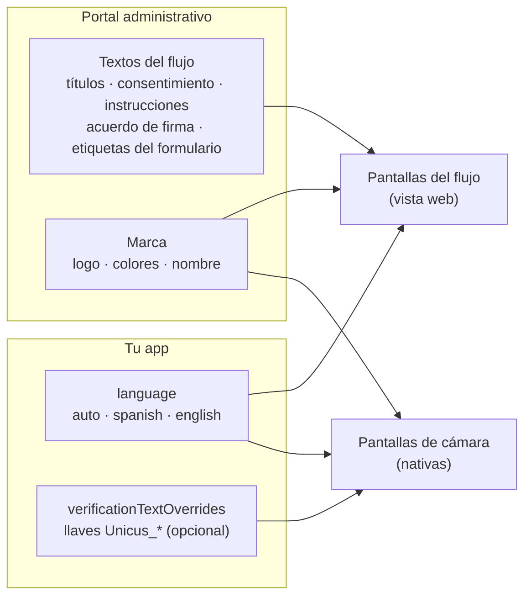

# Textos e idiomas

El SDK incluye todos sus textos en **español e inglés**. Una opción,
`UnicusSdkConfig.language`, elige el idioma de todo lo que muestra el SDK:

| `UnicusLanguage` | Idioma |
| --- | --- |
| `auto` (por defecto) | El idioma del dispositivo: español en un dispositivo en español, inglés en cualquier otro. |
| `spanish` | Siempre español. |
| `english` | Siempre inglés. |


```dart
await unicus.configure(const UnicusSdkConfig(
  apiKey: '<CUSTOMER_TOKEN>',
  environment: UnicusEnvironment.dev,
  language: UnicusLanguage.spanish,
));
```


Los textos de una verificación vienen de estos lugares:



| Pantallas | Textos | Idioma |
| --- | --- | --- |
| Pantallas de cámara (prueba de vida, documento, comparación facial) | Textos incluidos, reemplazados llave por llave por tu `verificationTextOverrides`. | `language`. Tus reemplazos se muestran tal como los entregas. |
| Confirmación de datos del documento (etiquetas de los datos leídos del documento) | Etiquetas incluidas, o tu `verificationOcrLocalization`. | `language`. |
| Pantallas del flujo (consentimiento, información, formulario, firma, OTP, resultados de los pasos de interfaz) | Textos fijos que mantiene Unicus, más los textos del flujo que escribes en el portal. | `language`. |
| Diálogo de salida y error de carga de las pantallas del flujo | Los SDK nativos. | `language`. |
| `result.resultMessage` | El catálogo de resultados de Unicus. | `language`. |

El diálogo de salida pregunta «¿Salir de la validación?» / "Leave the
verification?" e informa al usuario que su avance queda guardado y que puede
retomar la validación más tarde (consulta
[Resultados y reanudación](../results-and-resuming.md)).


Antes de esta versión las pantallas de cámara salían en inglés salvo que tu app
entregara un mapa en español, y `resultMessage` siempre venía en español. Con
el valor por defecto `auto`, un dispositivo en español ahora ve las pantallas
de cámara en español y un dispositivo en inglés recibe `resultMessage` en
inglés. Si tu app entregaba el mapa completo en español solo para traducir las
pantallas, reemplázalo por `language: UnicusLanguage.spanish`.


## Pantallas de cámara: cambiar algunos textos

Para cambiar la redacción de algunos textos, pasa en `configure` un mapa de
llaves `Unicus_*` con su texto. Tus textos ganan sobre los incluidos; las
llaves que no incluyas conservan el texto incluido en el idioma elegido.
`<br/>` se convierte en un salto de línea.


```dart
const myUnicusTexts = <String, String>{
  UnicusVerificationTextKey.actionImReady: 'COMENZAR',
  UnicusVerificationTextKey.cameraPermissionHeader: 'Activa la cámara',
  UnicusVerificationTextKey.retryHeader: 'Intentémoslo otra vez',
  'Unicus_idscan_type_selection_header': 'Prepárate para escanear<br/>tu documento',
};

await unicus.configure(const UnicusSdkConfig(
  apiKey: '<CUSTOMER_TOKEN>',
  environment: UnicusEnvironment.dev,
  language: UnicusLanguage.spanish,
  verificationTextOverrides: myUnicusTexts,
));
```


* `UnicusVerificationTextKey` tiene constantes para las llaves públicas
  (botones, permiso de cámara, indicaciones para encuadrar el rostro, captura
  y revisión del documento, mensajes de carga y resultado, pantalla de
  reintento, etiquetas de accesibilidad). También puedes escribir la llave
  como texto.
* Usa solo llaves con el prefijo `Unicus_`: son el contrato público y
  funcionan igual en Android e iOS.
* La app de ejemplo del paquete tiene los mapas completos en inglés y en
  español en `example/lib/sample_unicus_texts.dart`
  (`sampleUnicusEnglishTexts`, `sampleUnicusSpanishTexts`) como referencia
  para tu propia redacción.

### Reemplazos con el idioma del dispositivo

Un reemplazo tiene un solo texto, que se muestra en cualquier idioma. Con
`UnicusLanguage.auto`, fija el idioma o elige el mapa según el idioma de tu
app:


```dart
final language = Localizations.localeOf(context).languageCode;
await unicus.configure(UnicusSdkConfig(
  apiKey: customerToken,
  environment: UnicusEnvironment.dev,
  language: language == 'es' ? UnicusLanguage.spanish : UnicusLanguage.english,
  verificationTextOverrides: language == 'es' ? mySpanishTexts : myEnglishTexts,
));
```


### Confirmación de datos del documento

Las etiquetas de la pantalla en la que el usuario confirma los datos leídos
del documento vienen incluidas en ambos idiomas. Para reemplazarlas, usa
`verificationOcrLocalization`; coordina ese diccionario con soporte de
Tekbees.

## Pantallas del flujo

Las pantallas del flujo usan el idioma de `language` y muestran:

* Textos fijos (botones, errores, resultados) que Unicus mantiene en español e
  inglés.
* Los textos de tu flujo (títulos y descripciones de los pasos, texto de
  consentimiento y enlace de privacidad, instrucciones, acuerdo de firma,
  etiquetas del formulario), escritos en el editor de flujos del portal en
  español e inglés. Un texto llenado en un solo idioma se muestra tal cual en
  ambos.
* El nombre, el logo y los colores de tu compañía.

`verificationTextOverrides` no cambia las pantallas del flujo. Consulta
[Textos e idiomas del Web SDK](../../sdk-web-v5/texts-and-languages.md) para
la lista completa de textos del flujo, que se comparten con la web.

## Mensajes de resultado

`result.resultMessage` es el mensaje de Unicus para el código en el idioma
elegido. Le habla al usuario y le dice qué hacer, por ejemplo `4001` «Se
agotaron los intentos.» / "No attempts left.". Un motivo escrito por Unicus para
un paso rechazado se entrega tal cual.

`UnicusResultCode.messageFor(code)` devuelve el mensaje en español de un código
y `UnicusResultCode.messageFor(code, language: UnicusLanguage.english)` el
mensaje en inglés. Decide qué hacer según `outcome` y `resultCode`
([Códigos de resultado](../result-codes.md)), nunca comparando textos.
