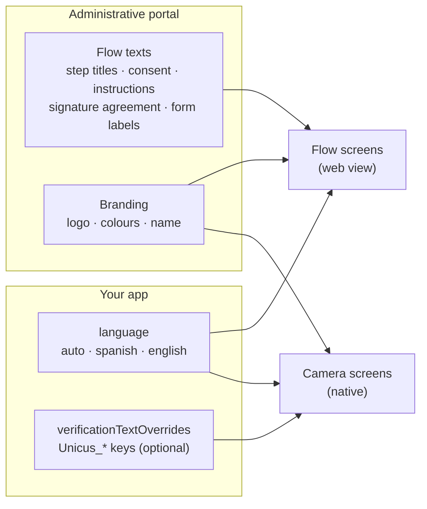

# Texts and languages

The SDK ships every text in **Spanish and English**. One option,
`UnicusSdkConfig.language`, picks the language of everything the SDK shows:

| `UnicusLanguage` | Language |
| --- | --- |
| `auto` (default) | The device language: Spanish on a Spanish device, English on any other. |
| `spanish` | Always Spanish. |
| `english` | Always English. |


```dart
await unicus.configure(const UnicusSdkConfig(
  apiKey: '<CUSTOMER_TOKEN>',
  environment: UnicusEnvironment.dev,
  language: UnicusLanguage.spanish,
));
```


The texts of a verification come from these places:



| Screens | Texts | Language |
| --- | --- | --- |
| Camera screens (liveness, document, face match) | Built-in texts, replaced key by key by your `verificationTextOverrides`. | `language`. Your overrides are shown as you pass them. |
| Document data confirmation (labels of the data read from the document) | Built-in labels, or your `verificationOcrLocalization`. | `language`. |
| Flow screens (consent, info, form, signature, OTP, results of UI steps) | Fixed texts maintained by Unicus, plus the flow texts you write in the portal. | `language`. |
| Exit dialog and load error of the flow screens | The native SDKs. | `language`. |
| `result.resultMessage` | The Unicus result catalog. | `language`. |

The exit dialog asks "¿Salir de la validación?" / "Leave the verification?"
and tells the user that their progress is saved and they can resume the
verification later (see [Results and resuming](../results-and-resuming.md)).


Before this version the camera screens were in English unless your app passed
a Spanish map, and `resultMessage` was always in Spanish. With the default
`auto`, a Spanish device now gets Spanish camera screens and an English device
gets `resultMessage` in English. If your app passed the complete Spanish map
only to translate the screens, replace it with
`language: UnicusLanguage.spanish`.


## Camera screens: change some texts

To change the wording of some texts, pass a map of `Unicus_*` keys to their
text in `configure`. Your texts win over the built-in ones; keys you do not
include keep the built-in text in the selected language. `<br/>` becomes a
line break.


```dart
const myUnicusTexts = <String, String>{
  UnicusVerificationTextKey.actionImReady: 'COMENZAR',
  UnicusVerificationTextKey.cameraPermissionHeader: 'Activa la cámara',
  UnicusVerificationTextKey.retryHeader: 'Intentémoslo otra vez',
  'Unicus_idscan_type_selection_header': 'Prepárate para escanear<br/>tu documento',
};

await unicus.configure(const UnicusSdkConfig(
  apiKey: '<CUSTOMER_TOKEN>',
  environment: UnicusEnvironment.dev,
  language: UnicusLanguage.spanish,
  verificationTextOverrides: myUnicusTexts,
));
```


* `UnicusVerificationTextKey` has constants for the public keys (buttons,
  camera permission, feedback while framing the face, document capture and
  review, upload and result messages, retry screen, accessibility labels).
  You can also write the key as a string.
* Use only keys with the `Unicus_` prefix: they are the public contract and
  work the same on Android and iOS.
* The example app of the package has the complete English and Spanish maps in
  `example/lib/sample_unicus_texts.dart` (`sampleUnicusEnglishTexts`,
  `sampleUnicusSpanishTexts`) as a reference for custom wording.

### Overrides with the device language

An override has a single text, shown whatever the language. With
`UnicusLanguage.auto`, either fix the language or choose the map for the
language of your app:


```dart
final language = Localizations.localeOf(context).languageCode;
await unicus.configure(UnicusSdkConfig(
  apiKey: customerToken,
  environment: UnicusEnvironment.dev,
  language: language == 'es' ? UnicusLanguage.spanish : UnicusLanguage.english,
  verificationTextOverrides: language == 'es' ? mySpanishTexts : myEnglishTexts,
));
```


### Document data confirmation

The labels of the screen where the user confirms the data read from the
document are built in, in both languages. To replace them, use
`verificationOcrLocalization`; coordinate that dictionary with Tekbees support.

## Flow screens

The flow screens use the language of `language` and show:

* Fixed texts (buttons, errors, results) maintained by Unicus in Spanish and
  English.
* The texts of your flow (step titles and descriptions, consent text and
  privacy link, instructions, signature agreement, form labels), written in
  the portal's flow editor in Spanish and English. A text filled in only one
  language is shown as is in both.
* Your company name, logo and colours.

`verificationTextOverrides` does not change the flow screens. See
[Texts and languages of the Web SDK](../../sdk-web-v5/texts-and-languages.md)
for the full list of flow texts, which are shared with the web.

## Result messages

`result.resultMessage` is the Unicus message for the code in the selected
language. It speaks to the user and says what to do next, for example `4001`
"Se agotaron los intentos." / "No attempts left.". A reason written by Unicus
for a rejected step is passed as it is.

`UnicusResultCode.messageFor(code)` returns the Spanish message of a code and
`UnicusResultCode.messageFor(code, language: UnicusLanguage.english)` the
English one. Decide what to do from `outcome` and `resultCode`
([Result codes](../result-codes.md)), never by comparing message texts.
